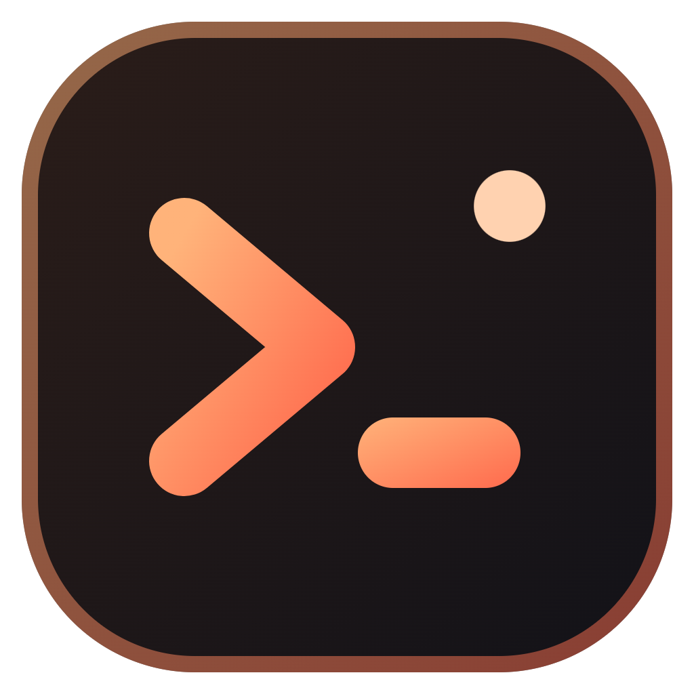
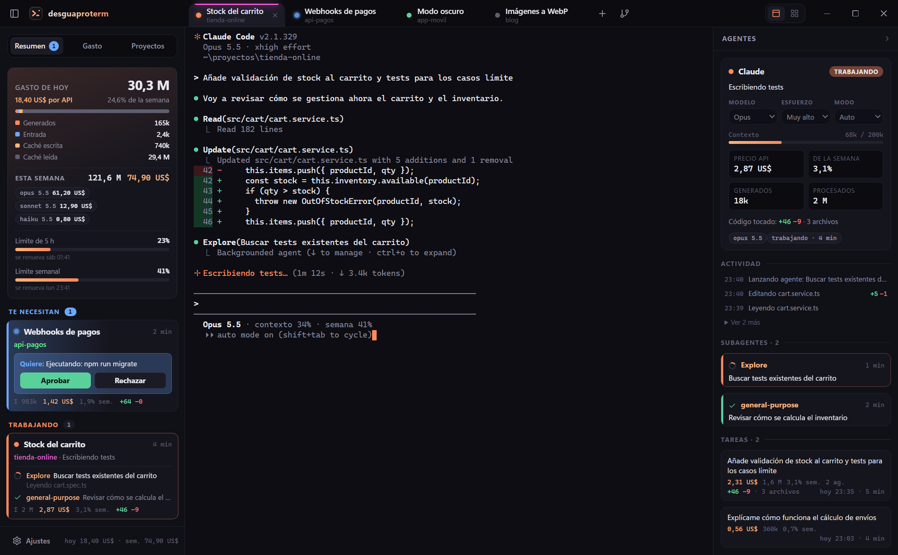
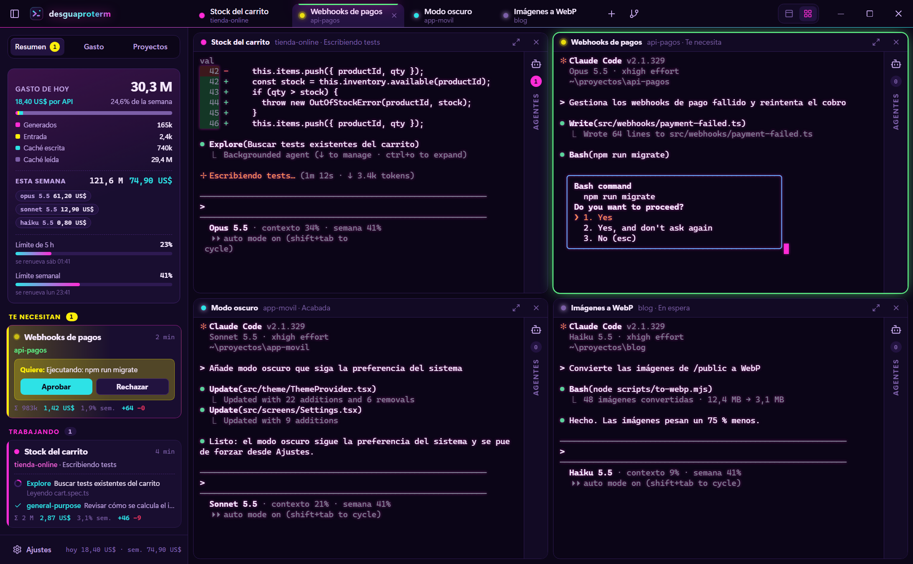
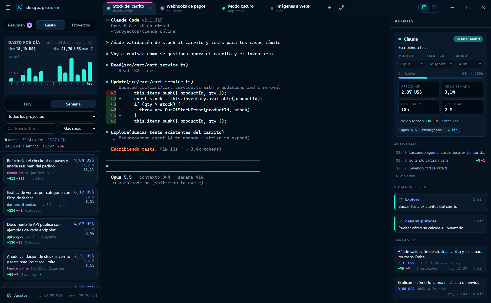
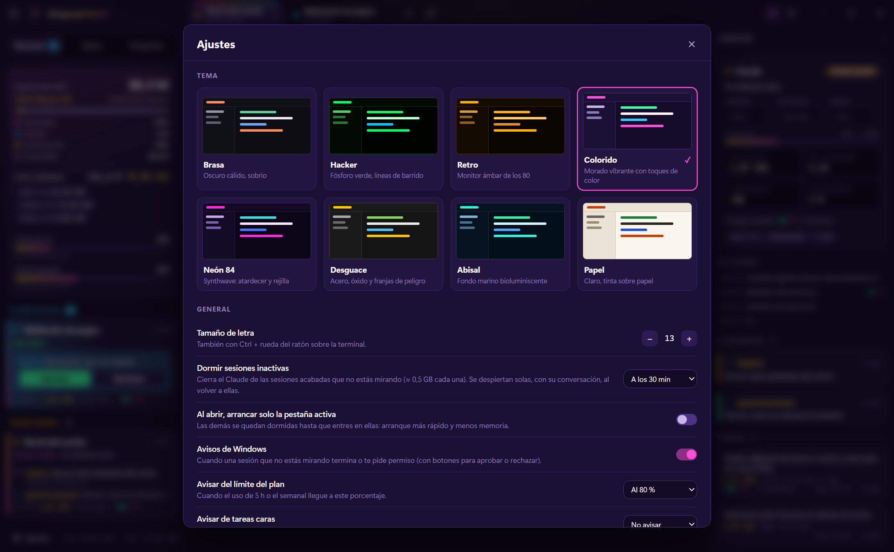
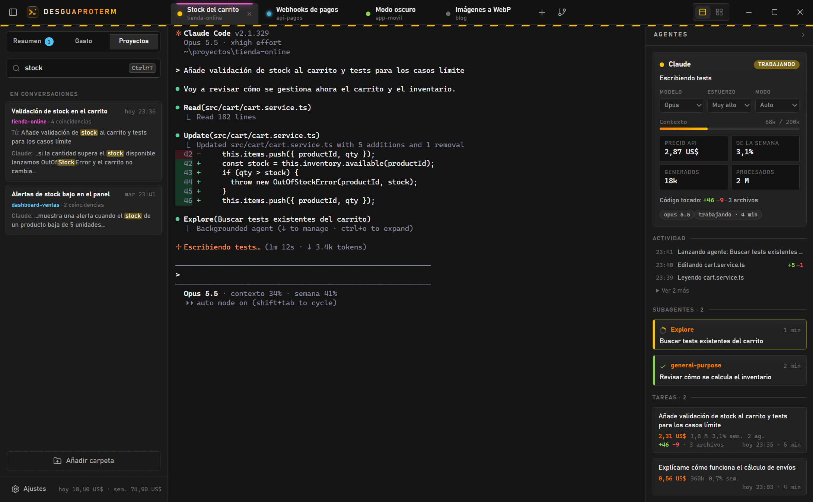
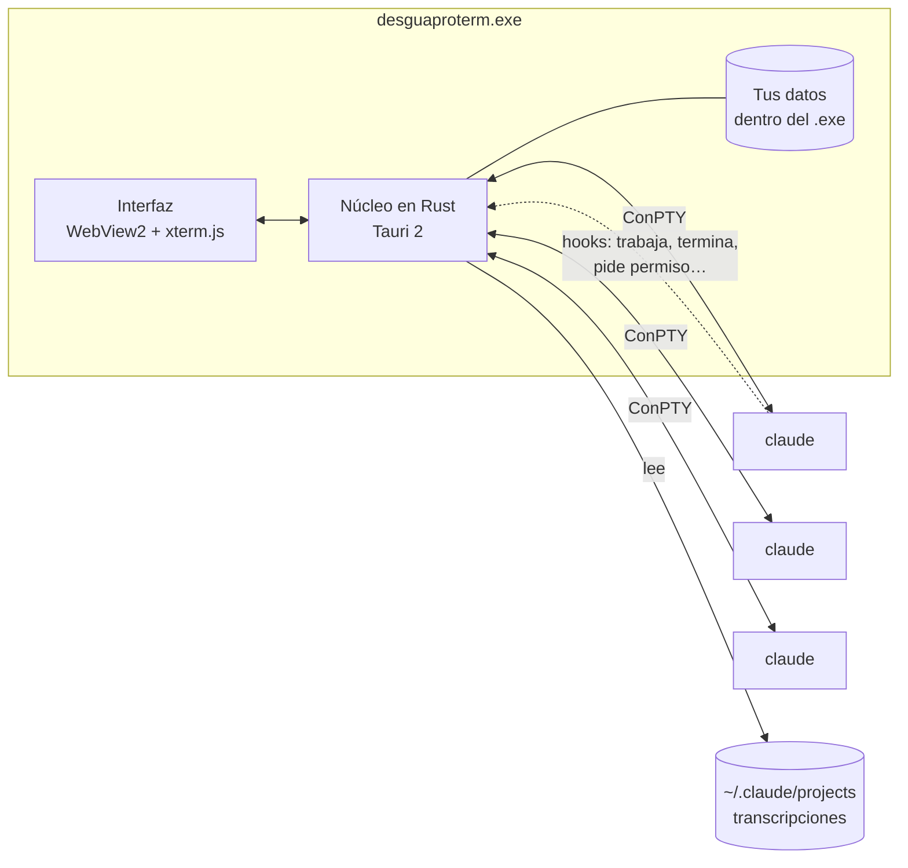

<div align="center">



# desguaproterm

**La terminal para trabajar con varios Claude Code a la vez.**<br>
Todas tus sesiones a la vista, qué está haciendo cada una, cuánto gasta y cuál te necesita.




</div>

---

Cuando tienes cuatro o cinco Claude Code abiertos, lo difícil no es usarlos: es saber cuál ha terminado, cuál está esperando tu permiso y cuánto llevas gastado. **desguaproterm** pone todo eso en una sola ventana, y al volver a encender el PC te devuelve cada sesión con su conversación, donde la dejaste.

## Lo que hace

<table>
<tr>
<td width="50%" valign="top">

### Todo a la vista
- **Pestañas o cuadrícula.** Cada pestaña dice en 2-3 palabras de qué va su sesión.
- **Resumen en vivo:** *Te necesitan*, *Trabajando*, *Acabadas*.
- **Aprobar o rechazar** permisos sin cambiar de pestaña, o desde el **aviso de Windows**.
- **Panel de agentes** en cada sesión: subagentes, qué está haciendo cada uno y actividad reciente con su diff.

</td>
<td width="50%" valign="top">

### Gasto bajo control
- **Tokens y precio por API** de cada tarea, cada sesión y cada día.
- **% de la semana** al lado de cada consumo.
- **Límites reales de tu plan** (5 h y semanal) y aviso al llegar al 80 %.
- **Líneas tocadas** por tarea (`+120 −34 · 5 archivos`) y gráfica de los últimos 14 días.

</td>
</tr>
<tr>
<td valign="top">

### Nunca pierdes una sesión
- Al reabrir la app vuelven **las mismas pestañas con su conversación**, aunque hayas hecho `/clear`.
- **Sesiones dormidas:** las que llevan un rato acabadas sueltan su memoria (~0,5 GB cada una) y se despiertan solas al volver a ellas.
- **Sesiones aisladas** en su propio *worktree* de git, para que dos Claude no se pisen en el mismo proyecto.

</td>
<td valign="top">

### Cómodo de verdad
- **Modelo, esfuerzo y modo** por sesión, sin tocar tu configuración global.
- **Lanzador de proyectos** y **buscador** en todas tus conversaciones antiguas.
- **Ctrl+V con imágenes**, arrastrar archivos y vista previa al pasar por `[Image #1]`.
- **8 temas**, de sobrio a synthwave.

</td>
</tr>
</table>

## Capturas

<table>
<tr>
<td width="50%"><br><sub><b>Cuadrícula</b>: cuatro sesiones a la vez (tema Neón 84)</sub></td>
<td width="50%"><br><sub><b>Gasto</b>: por día, por tarea, con filtros (tema Abisal)</sub></td>
</tr>
<tr>
<td><br><sub><b>Ajustes</b>: 8 temas, avisos y ahorro de memoria</sub></td>
<td><br><sub><b>Buscador</b>: encuentra cualquier conversación (tema Desguace)</sub></td>
</tr>
</table>

<sub>Las capturas usan proyectos y datos de ejemplo.</sub>

## Empezar

1. Ten **[Claude Code](https://docs.claude.com/en/docs/claude-code)** instalado y con la sesión iniciada.
2. Descarga **`desguaproterm.exe`** desde [Releases](../../releases/latest).
3. Ponlo en una carpeta tuya (Escritorio, Documentos…) y ábrelo. No necesita instalación.

¿Prefieres compilarlo tú? Mira [Compilar](#compilar).

> Windows 10/11 con WebView2, que Windows 11 ya trae. Como el `.exe` no va firmado, la primera vez SmartScreen puede avisar: *Más información → Ejecutar de todas formas*.

### Atajos

| Atajo | Acción |
|---|---|
| `Ctrl+Shift+T` | Buscar proyecto o conversación |
| `Ctrl+Shift+N` | Otra sesión en la misma carpeta |
| `Ctrl+Shift+G` | Pestañas ↔ cuadrícula |
| `Ctrl+Shift+A` | Panel de agentes |
| `Ctrl+Shift+B` | Mostrar u ocultar el resumen |
| `Ctrl+Shift+W` | Cerrar sesión (se puede deshacer) |
| `Ctrl+Tab` · `Alt+1…9` | Cambiar de sesión |
| `Ctrl+,` | Ajustes y temas |
| `Shift+Enter` | Salto de línea en el mensaje |

## Cómo funciona



- Cada pestaña es un **Claude Code real** dentro de una pseudoterminal de Windows. La app no sustituye a Claude: lo organiza.
- **Hooks** de Claude Code, que solo se aplican a las sesiones abiertas desde aquí, avisan al instante de cada cambio de estado. Tu configuración global de Claude no se toca.
- El gasto, los títulos, los subagentes y las líneas tocadas salen de las **transcripciones** que Claude ya guarda en tu PC. El precio usa las tarifas públicas de la API de Anthropic.
- **Todo cabe en un `.exe` de 5,5 MB.** Tus pestañas y ajustes se guardan dentro del propio archivo (flujos de datos NTFS), sin carpetas de configuración.
- **Nada sale de tu PC:** sin telemetría, sin cuentas y sin servidores propios.

## Compilar

Hace falta [Rust](https://rustup.rs), [Node.js](https://nodejs.org) y las Build Tools de Visual Studio (C++).

```powershell
npm install
npx tauri build --no-bundle          # → src-tauri/target/release/desguaproterm.exe
powershell -ExecutionPolicy Bypass -File instalar.ps1   # compila e instala conservando tus datos
```

| Carpeta | Qué hay |
|---|---|
| `src-tauri/src/main.rs` | Pseudoterminales, sesiones, avisos, comandos para la interfaz |
| `src-tauri/src/monitor.rs` | Estados, tokens, tareas, subagentes, actividad y buscador |
| `src-tauri/src/pricing.rs` | Tarifas de la API por modelo |
| `src-tauri/src/store.rs` | Datos guardados dentro del `.exe` |
| `ui/` | Interfaz: `app.js`, `panels.js`, `themes.js`, estilos |

## Créditos

Hecho con [Tauri](https://tauri.app), [xterm.js](https://xtermjs.org) (licencia MIT, ver `ui/vendor/LICENSE-xterm.txt`) y [portable-pty](https://github.com/wezterm/wezterm/tree/main/pty).

<sub>Proyecto personal y no oficial: no está afiliado ni respaldado por Anthropic. Claude y Claude Code son marcas de Anthropic.</sub>
